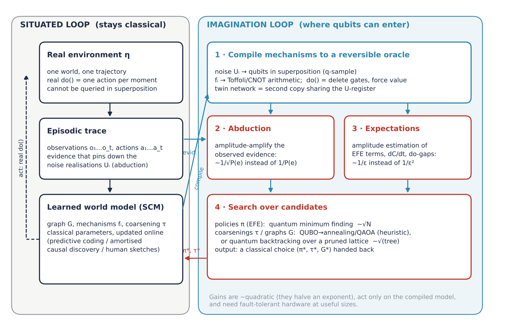

A working paper (14 pages) asking a blunt question: could quantum computers make the expensive parts of
counterfactual learning cheap? That means extracting a causal graph, running interventions, answering
"what would have happened if" while holding the noise fixed, and choosing whichever candidate most improves
compression or most reduces surprise.

**The form fits beautifully.** Each step of that loop maps onto standard quantum machinery. The noise terms
of a causal model become qubits. The structural equations become reversible gates. An intervention is
literally deleting gates. Pearl's "twin network" for counterfactuals is a second copy of the circuit wired to
the same noise qubits. Small simulated circuits reproduce the exact answers for all three rungs of Pearl's
ladder.

{: width="1656" }
_The situated loop, acting in the one real world, stays classical. Qubits can only enter the imagination loop: rollouts of the learned causal model._

**The speed-ups are real but mostly quadratic.** Conditioning on rare evidence, estimating an expected
free energy, and searching over candidate policies or coarsenings each get a square-root saving. That roughly
doubles the planning horizon or graph size you can afford. It does not turn exponential problems into easy
ones. Tractability still has to come from structure: amortisation, pruning, and human proof sketches.

**The situated agent survives.** A quantum speed-up needs an environment that can be queried in
superposition. The real world can't be. So qubits can only help the *imagination* half of the loop, the
rollouts of a learned model, while the particulars still have to be gathered one real intervention at a time.

The paper ends with honest crossover estimates (error-correction overheads are brutal) and a programme a
private individual can actually do now: simulators, resource estimates, and quantum-inspired classical
methods.

[Read the paper (PDF, 14 pages)]({{ '/assets/pdf/Qubits-for-Causal-Compression.pdf' | relative_url }})

*Its successor, [Interference, Not Parallelism]({{ '/posts/interference-not-parallelism/' | relative_url }}), argues that
this paper asked the question the wrong way.*
