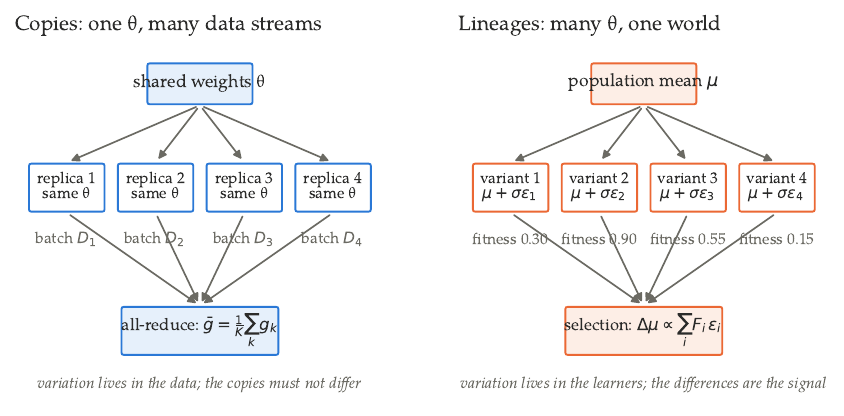

An essay (20 pages) comparing the three systems on this planet that learn at scale: evolving populations,
brains, and the gradient-trained networks behind large language models.

The usual comparison puts them on one axis, biological versus artificial. This essay uses three:

- **Where the learning signal comes from:** estimated from variation, or computed exactly.
- **Whether what is learned can be copied:** shared weights, or a lineage of unique individuals.
- **Where precision comes from:** paid for up front with error correction, or earned by averaging over noise.

The argument is that these are really one distinction. Reproducibility, shareability and the need for an
explicit gradient come bundled together. Noise, uniqueness and learning by variation are the opposite bundle.

{: width="844" }
_Copies share one set of weights and differ in their data. Lineages differ in their weights, and the differences are the signal._

The first half is grounded material: evolution strategies and the Lande equation as gradient estimators,
Hinton's "mortal computation", the energy cost of reliable bits from Landauer's limit up to DRAM, and how
precision scales in counting, sigma-delta and timing codes.

The second half is speculative and says so. It proposes eight associations that haven't, as far as I know,
been drawn together. Among them: species as connected basins in a fitness landscape, representational drift in
brains as neutral evolution, and synaptic failure as a built-in evolution strategy. Each comes with a way to
test it.

[Read the essay (PDF, 20 pages)]({{ '/assets/pdf/Copies-Lineages-and-Noise.pdf' | relative_url }})
