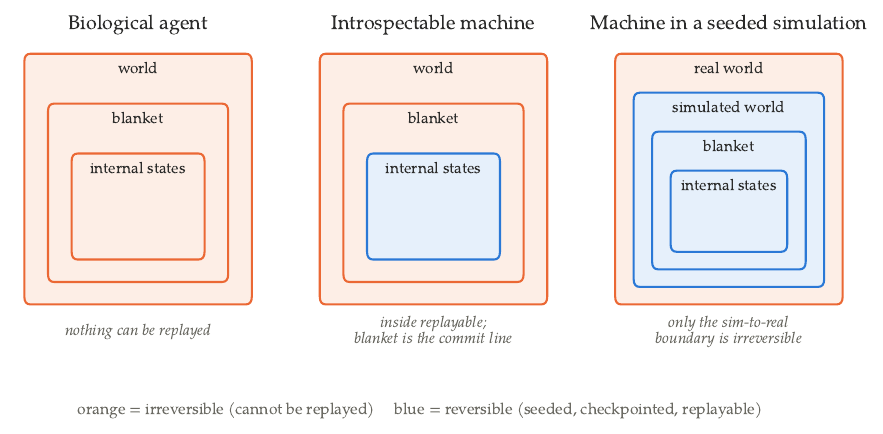
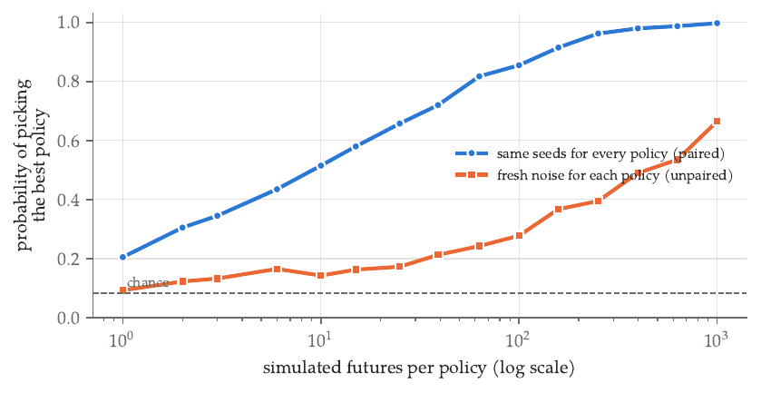

An annex to [Paths Not Taken]({{ '/posts/paths-not-taken/' | relative_url }}), in a short edition (7 pages) and an
expanded one (20 pages), with a panel discussion.

Friston's free energy principle describes adaptive systems as minimising a quantity that bounds surprise. In
practice almost every quantity it asks for is hard to compute. Beliefs about hidden causes must be approximated,
model evidence is intractable, the value of a plan needs averages over futures that grow exponentially, and
learning the structure of a causal model means searching a space that grows faster still.

The annex asks which of those obstacles shrink when two new capabilities are added:

- **Inside the blanket:** the agent can replay its own randomness, inspect its own states, and intervene on its
  own model. Uncertainty about itself becomes largely removable, and the Markov blanket turns out to coincide with
  the line where things become irreversible.
- **Outside the blanket:** the world is a seeded simulation that can be replayed and intervened on too. There,
  causal discovery becomes close to an engineering problem, solved with paired experiments, exact
  counterfactuals and program analysis.

{: width="883" }
_Orange is irreversible, blue is replayable. As more becomes replayable, the irreversible boundary moves outward._

What stays scarce is the invention of good concepts, the choice of which outcomes matter, and honesty about
reality. That's where human judgement and real, irreversible evidence keep their value.

{: width="839" }
_Comparing options under the same seeds finds the best one with far fewer trials than comparing under fresh noise._

- [Read the short edition (PDF, 7 pages)]({{ '/assets/pdf/Opening-the-Markov-Blanket.pdf' | relative_url }})
- [Read the expanded edition (PDF, 20 pages)]({{ '/assets/pdf/Opening-the-Markov-Blanket-expanded.pdf' | relative_url }})

## Panel discussion

The same four synthetic voices on the expanded edition. 43 minutes.

<audio controls preload="none" style="width:100%" src="{{ '/assets/audio/Opening-the-Markov-Blanket-Panel.mp3' | relative_url }}"></audio>

| Time | Chapter |
|---:|:---|
| 0:00 | Welcome, and what calculable means |
| 2:59 | The free energy principle, and its six bottlenecks |
| 7:46 | The coarse causal graph as a free energy object |
| 10:01 | Inside the blanket, part one |
| 14:04 | Inside the blanket, part two |
| 21:15 | The blanket itself |
| 23:25 | Outside the blanket, in a simulation, part one |
| 28:53 | Outside the blanket, in a simulation, part two |
| 33:20 | Eliciting the coarse causal graph |
| 39:57 | What stays incalculable, and closing |
