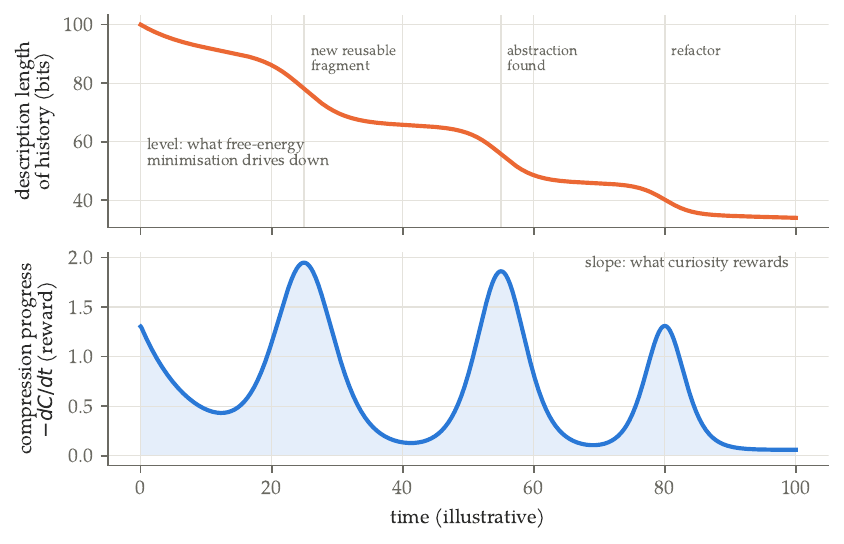

The central essay of this archive (32 pages), with a panel discussion of it.

Machine learners can do things no evolved learner can. They can rewind to an earlier state, replay the same
randomness, edit one stored fact, copy themselves, and run an exact experiment on their own mind. People can do
none of this: we can't un-read a book. The essay asks what these powers change about learning, and how such
learners should be combined with people, each of whom extracts causal structure in their own way.

It makes four arguments.

1. **What matters is what is held fixed.** The useful distinction isn't which rung of Pearl's ladder of
   causation a learner reaches, but what it can hold fixed while it varies something else.
2. **Irreversibility is a resource to be placed.** Fresh information only enters a system through events that
   can't be undone. Reversibility multiplies the value of that information, but it also leaks it, because every
   retry against the same judge teaches the learner about the judge. In a human–machine system the
   irreversibility tends to collect at the people.
3. **Transformers almost have an algebra of structure.** They already contain most of the machinery of sparse
   and hyperdimensional codes, but lack an explicit *binding* operation. Adding one could make causal structure
   and its counterfactuals readable and editable.
4. **Compression progress is the right objective for the joint system.** Schmidhuber's curiosity, measured as
   the *rate* of improvement in explaining experience, complements Friston's minimised surprise. Measuring it
   needs exactly the rewind that machines have and people lack.

{: width="844" }
_Free-energy minimisation drives the level of description length down. Curiosity rewards the slope: the moments when a new, reusable piece of structure is found._

Along the way it introduces, at the level of ideas rather than formulas, the mathematics these arguments draw on:
sparse codes, vector-symbolic algebra, category theory, topology, and the theory of reusing an evaluator
without overfitting to it.

[Read the essay (PDF, 32 pages)]({{ '/assets/pdf/Paths-Not-Taken.pdf' | relative_url }})

## Panel discussion

A synthetic four-voice panel (host, librarian, questioner and main discussant) talking through the essay. 106 minutes.

<audio controls preload="none" style="width:100%" src="{{ '/assets/audio/Paths-Not-Taken-Panel.mp3' | relative_url }}"></audio>

| Time | Chapter |
|---:|:---|
| 0:00 | Welcome, and the question |
| 4:46 | What carries over from the earlier essay |
| 8:32 | Counterfactuals, and what is held fixed |
| 20:40 | What reliable hardware is worth to an optimiser |
| 25:33 | Irreversibility as a resource |
| 42:38 | From fractured to structured representations |
| 58:15 | Causal structure inside vectors |
| 66:02 | Mathematics beyond probability |
| 80:06 | Compression progress and curiosity |
| 89:51 | Development, and the missing dimensions |
| 95:57 | Toward a symbiotic optimum |
| 100:58 | Open questions, and closing |

The papers behind the essay are collected in [Thirty Papers Behind the Discussion]({{ '/posts/thirty-papers-behind-the-discussion/' | relative_url }}).
