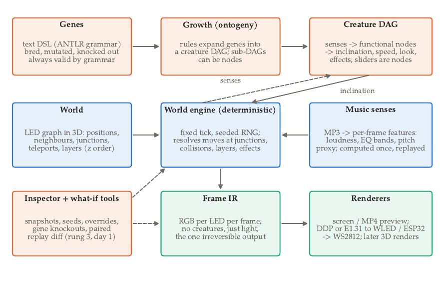

The art project that gives the research a world to live in.

Small "creatures" made of light wander a sculpture of LED strips, a grid of a few hundred to a few thousand
lights, and react to music: they flinch at loud noises, chase colours, leave trails, burst into sparks. People
don't steer them. They breed them, choose genes by plain-language descriptions like "easily spooked by noise",
and set a few personality sliders. Then the creature goes wherever it goes. Art can't be wrong, only ugly, which
makes it a forgiving place to experiment.

For the research, what matters is that the world is **completely replayable**. Every run is seeded, so it
repeats exactly. Any value at any moment can be changed and the two runs compared. Creatures are data, lists of
named genes, rather than code. So "what would this creature have done if that gene were switched off?" is not a
guess but an experiment, and the counterfactual machinery of the essays becomes something you can watch.

{: width="891" }
_From genes to creature, through a deterministic world engine driven by the music, out to pure light: colours per LED per frame._

Two documents:

- **Direction of travel** (7 pages): the high-level view. What to build first, what must be right from day one,
  and what can stay simple and be swapped for something better later.
- **Scaffold spec** (6 pages): the design brief for the first version, covering structure, file formats and the
  rules that keep runs exactly reproducible. It's included for the record. No code or hardware designs are
  published here.

- [Read the direction of travel (PDF, 7 pages)]({{ '/assets/pdf/LED-Creatures-Direction-of-Travel.pdf' | relative_url }})
- [Read the scaffold spec (PDF, 6 pages)]({{ '/assets/pdf/LED-Creatures-Scaffold-Spec.pdf' | relative_url }})

## Panel discussion

What the art project is, what's in the first version, how it links back to the research, and how it could grow. 54 minutes.

<audio controls preload="none" style="width:100%" src="{{ '/assets/audio/LED-Creatures-Panel.mp3' | relative_url }}"></audio>

| Time | Chapter |
|---:|:---|
| 0:00 | Welcome, and what this session is |
| 1:30 | The art project |
| 7:36 | What's in the first milestone |
| 16:53 | Walkthrough: one frame in the life of the world |
| 21:19 | Why it's built this way: the spine |
| 32:53 | Walkthrough: from a sentence to a bred creature |
| 37:36 | How it extends later |
| 46:23 | Questions from the panel |
| 51:08 | Risks, first steps, and closing |
